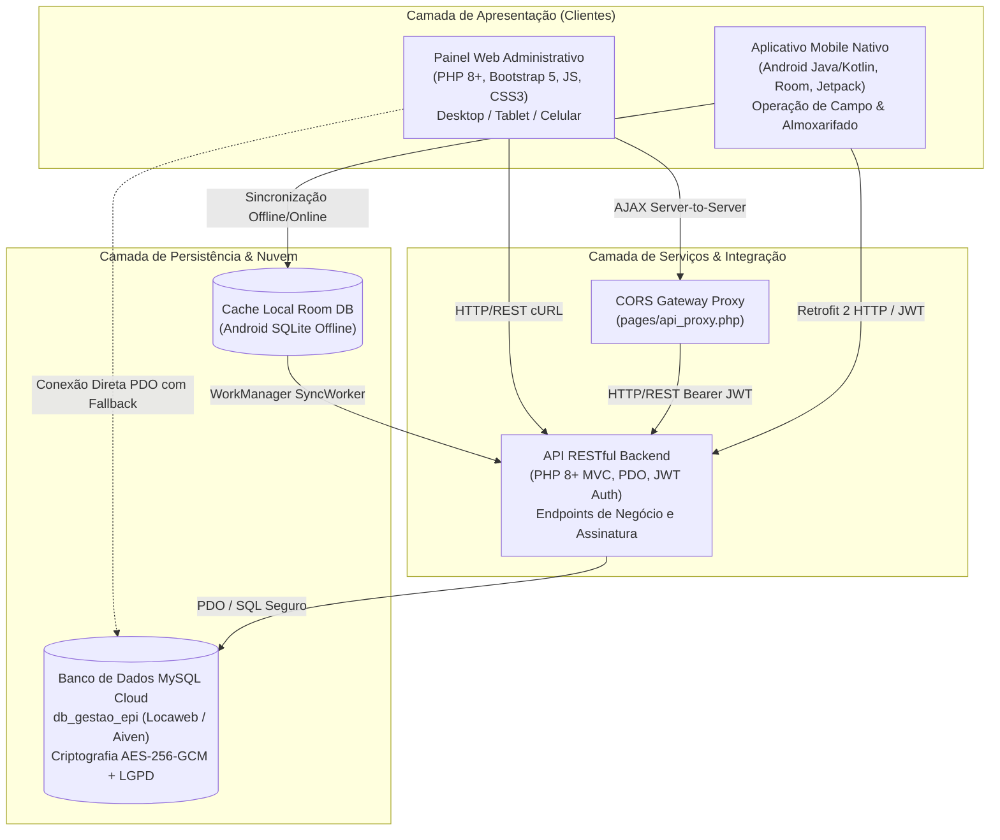

# Arquitetura Integrada do Ecossistema Gestão EPI

Este documento detalha a arquitetura geral, os componentes de software, os canais de comunicação e a governança de dados do ecossistema corporativo **Gestão EPI**, projetado para gestão, controle e conformidade trabalhista (NR-6, Ministério do Trabalho e Emprego) e jurídica (LGPD) no fornecimento de Equipamentos de Proteção Individual.

---

## 1. Visão Geral do Ecossistema

O ecossistema é formado por três pilares tecnológicos complementares que operam de maneira harmônica sobre uma base de dados relacional compartilhada:

---

## 2. Componentes, URLs e Papéis de Cada Projeto

| Projeto | Repositório / Ambiente | Tecnologias Principais | Papel no Ecossistema |
| :--- | :--- | :--- | :--- |
| **Gestão EPI Web** | [projetoEtec26/gestao_epi_web](https://github.com/projetoEtec26/gestao_epi_web) *(Oficial ETEC)* [ronaldogomesdasilva/gestao_epi_web_14](https://github.com/ronaldogomesdasilva/gestao_epi_web_14) *(Pessoal)* Prod: `http://gestaoepi.tecnologia.ws/` Local: `http://localhost/OLD/gestao_epi_web_14/` | PHP 8+, Bootstrap 5, Vanilla JS, Chart.js, CSS3 HSL | Painel gerencial, emissão de relatórios com rótulos de dados integrados, gestão de colaboradores, entregas com lote (NR-6), devoluções, auditoria e controle de C.A. Suporta Desktop, Tablet e Celular. |
| **Gestão EPI API** | [projetoEtec26/gestao_epi_api](https://github.com/projetoEtec26/gestao_epi_api) Cloud: `https://gestao-epi-api.onrender.com/` | PHP 8+, MVC REST, JWT, Bcrypt, OpenSSL | Camada de serviços e regras de negócio para autenticação de operadores, assinaturas eletrônicas, registro de movimentações e logs de auditoria. |
| **Gestão EPI Mobile** | Projeto Android Nativo (`gestao_epi_8`) | Android (Java/Kotlin), Room, Retrofit 2, OkHttp, WorkManager | Coleta de dados no canteiro de obras e chão de fábrica, validação de biometria/PIN de 6 dígitos em campo e operação resiliente offline. |
| **Banco de Dados** | `db_gestao_epi` (`db_gestao_epi.mysql.dbaas.com.br`) | MySQL 8.0+ / MariaDB na Nuvem (Locaweb / Aiven) | Armazenamento centralizado, rastreabilidade de lotes (NR-6), criptografia de dados pessoais (LGPD) e integridade referencial. |

---

## 3. Fluxo de Autenticação e Autorização (RBAC e JWT)

O ecossistema implementa autenticação em dois níveis:
1. **Operadores do Sistema (Web e Mobile):**
   - Autenticação via login e senha com hash seguro **Bcrypt** (`cost => 10`).
   - Geração de token de acesso **JWT (JSON Web Token)** assinado com algoritmo SHA-256 (`HS256`).
   - Controle de Acesso Baseado em Papéis (**RBAC**): `ADMINISTRADOR`, `TECNICO_SST`, `ALMOXARIFE`, `GESTOR_CONTRATO`, `RH_ADMINISTRATIVO`.
   - O primeiro acesso impõe obrigatoriamente a troca de senhas temporárias antes de liberar o acesso às rotas restritas.

2. **Colaboradores Receptores de EPI (Assinatura Eletrônica):**
   - Assinatura digital do termo de entrega realizada através de **PIN numérico de 6 dígitos**.
   - O PIN é protegido por **SHA-256 com Salt hexadecimal de 16 bytes** exclusivo por colaborador:
     $$\text{Hash} = \text{sha256}(\text{PIN} + \text{Salt})$$
   - Implementação 100% idêntica e compatível entre a classe `HashUtils.java` (Android) e o `SecurityService.php` (Web).
   - O PIN padrão inicial atribuído a novos colaboradores cadastrados é `123456`, exigindo ativação ou redefinição assistida.

---

## 4. Rastreabilidade de Lotes e Conformidade NR-6

De acordo com as exigências da **Norma Regulamentadora NR-6** e auditorias de fiscalização trabalhista:
* **Obrigatoriedade de Lote:** Todo EPI entregue a um colaborador deve possuir número de lote registrado e visível no Recibo Eletrônico de Entrega.
* **Garantia em Cascata:**
  1. Utiliza o lote específico do lote de aquisição (`itens_entrega.item_numero_lote`).
  2. Fallback para o lote cadastrado no equipamento (`epis.epi_numero_lote`).
  3. Fallback para a identificação patrimonial (`epis.epi_identificacao`).
  4. Fallback determinístico de rastreabilidade: `LT-{ano_entrega}-{epi_id}`.
* Sob nenhuma hipótese o recibo exibe `---`, `N/A` ou valores nulos para o lote.

---

## 5. Governança e Segurança de Dados (LGPD)

* **Criptografia AES-256-GCM:** O CPF e o eSocial dos colaboradores são criptografados em repouso no banco com chave simétrica de 256 bits, IV aleatório de 12 bytes e Tag GCM de autenticação de 16 bytes.
* **Blindagem de Busca Cega:** Consultas exatas de CPF utilizam o hash indexado HMAC-SHA256 (`fun_cpf_lookup`), evitando a descriptografia em lote para operações de busca.
* **Mascaramento Preventivo:** A interface Web e o aplicativo exibem CPFs formatados e mascarados no padrão `***.456.789-**` para operadores não autorizados.
* **Auditoria Contínua:** Toda exportação de dados, alteração de status ou assinatura é registrada na tabela `log_auditoria` com endereço IP, navegador/dispositivo, data/hora e payload JSON.

---

## 6. Governança, Cibersegurança e Entrega Contínua (Release 8.5.1 Hardened)

Em conformidade com a auditoria e implementação de **Hardening e Multi-Repositório (09/11/2026 – 13/11/2026)** documentada em [`docs/AUDITORIA_CYBERSECURITY.md`](file:///c:/xampp/htdocs/OLD/gestao_epi_web_14/docs/AUDITORIA_CYBERSECURITY.md) e com as regras de engenharia em [`.agents/rules/`](file:///c:/xampp/htdocs/OLD/gestao_epi_web_14/.agents/rules/):
* **Sincronização Multi-Repositório Git (`etec` e `origin`):** Gestão coordenada do repositório oficial da ETEC (`projetoEtec26/gestao_epi_web`) — com gatilho automático de CI/CD para deploy FTP na Locaweb — e do repositório espelho pessoal (`ronaldogomesdasilva/gestao_epi_web_14`), mantendo total alinhamento de commits semânticos.
* **Comunicação Criptografada e Fuso Horário Oficial (`America/Sao_Paulo`):** Todo o sistema opera sob o fuso horário padrão do Brasil (`.agents/rules/fuso_horario_brasil.md`) configurado em `.htaccess` (`SetEnv TZ America/Sao_Paulo`), PHP (`date_default_timezone_set('America/Sao_Paulo')`) e MySQL (`SET time_zone = '-03:00'`), com cabeçalhos de segurança HTTP e HSTS.
* **Proteção e Isolamento do Banco de Dados:** Remoção de dumps de banco do Git, eliminação de senhas hardcoded em produção e suporte a carregamento isolado em `/home/usuario/secrets.php`.
* **Sessões e Cookies Dedicados (`GESTAOEPI_SID`):** Sessões PHP inicializadas com o cookie dedicado `GESTAOEPI_SID` e flags `; HttpOnly; SameSite=Lax; Secure` via `SecurityService::initSecureSession()`.
* **Estabilização Visual e Relatórios Ricos:** Gráficos com rótulos de valores diretamente visíveis (R$, %, unidades), desempate determinístico alfanumérico no Top 5 EPIs, contraste corrigido nas abas ativas no modo claro e renderização íntegra de ícones de auditoria.
* **Proteção Anti-CSRF e Anti-Força Bruta:** Rate limit com bloqueio temporário de 60 segundos após 5 tentativas de login consecutivas e validação de tokens anti-CSRF.
* **Governança RBAC e LocalStorage:** Módulos de auditoria e usuários restritos ao perfil `ADMINISTRADOR` e purga completa de tokens JWT do `localStorage` do navegador.
* **Commit e Publicação Obrigatória (`.agents/rules/commit_obrigatorio.md` e `multiplataforma.md`):** Toda modificação validada no XAMPP nas três plataformas (Web Desktop, Tablet e Celular) recebe obrigatoriamente commit semântico (*Conventional Commits*) e push para a branch `main` no GitHub, acionando o deploy contínuo na Locaweb.
* **Compatibilidade 100% Preservada:** Zero alterações contratuais na API REST; paridade total com o aplicativo Android mantida.

---

## 7. Rastreabilidade e Catálogo de Documentações Especializadas

O ecossistema mantém 8 manuais especializados na pasta [`docs/`](file:///c:/xampp/htdocs/OLD/gestao_epi_web_14/docs/):

1. **[Arquitetura do Ecossistema](file:///c:/xampp/htdocs/OLD/gestao_epi_web_14/docs/ARQUITETURA_ECOSSISTEMA.md):** Topologia global e integração dos 3 pilares de software.
2. **[Painel Web Administrativo](file:///c:/xampp/htdocs/OLD/gestao_epi_web_14/docs/PAINEL_WEB_ADMINISTRATIVO.md):** Manual completo das 18 páginas, Design System HSL, submenus e compatibilidade multiplataforma.
3. **[API RESTful Endpoints](file:///c:/xampp/htdocs/OLD/gestao_epi_web_14/docs/API_REST_ENDPOINTS.md):** Dicionário de rotas, contratos JSON, autenticação JWT e sincronização mobile.
4. **[Módulo Mobile Android](file:///c:/xampp/htdocs/OLD/gestao_epi_web_14/docs/MOBILE_ANDROID.md):** App Android nativo (Kotlin/Room), resiliência offline e assinatura por PIN.
5. **[Banco de Dados & Governança LGPD](file:///c:/xampp/htdocs/OLD/gestao_epi_web_14/docs/BANCO_DE_DADOS_LGPD.md):** Modelagem DDL relacional, criptografia AES-256-GCM e trilha judicial.
6. **[Guia de Implantação e DevOps](file:///c:/xampp/htdocs/OLD/gestao_epi_web_14/docs/GUIA_DE_IMPLANTACAO_E_DEVOPS.md):** Instalação local XAMPP, nuvem Locaweb/Render, CI/CD GitHub Actions e compilação do APK.
7. **[Fluxos Operacionais e Casos de Uso](file:///c:/xampp/htdocs/OLD/gestao_epi_web_14/docs/FLUXOS_OPERACIONAIS_E_CASOS_DE_USO.md):** Diagramas de sequência para admissão, fornecimento com lote e devoluções.
8. **[Relatório de Auditoria de Cybersecurity](file:///c:/xampp/htdocs/OLD/gestao_epi_web_14/docs/AUDITORIA_CYBERSECURITY.md):** Diagnóstico OWASP Top 10, matriz de riscos e plano diretor de mitigação.

