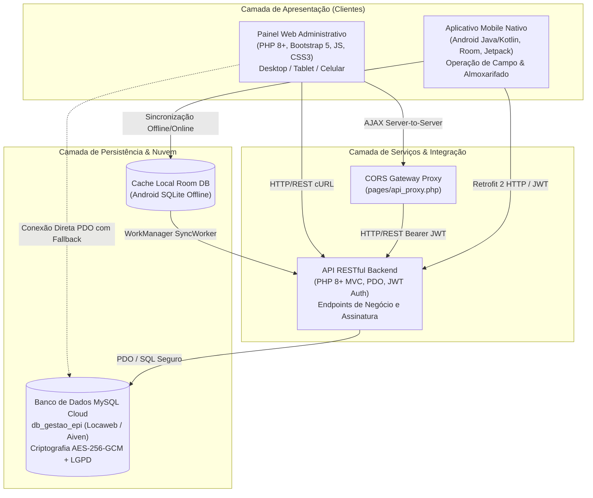

# Arquitetura Integrada do Ecossistema Gestão EPI

Este documento detalha a arquitetura geral, os componentes de software, os canais de comunicação e a governança de dados do ecossistema corporativo **Gestão EPI**, projetado para gestão, controle e conformidade trabalhista (NR-6, Ministério do Trabalho e Emprego) e jurídica (LGPD) no fornecimento de Equipamentos de Proteção Individual.

---

## 1. Visão Geral do Ecossistema

O ecossistema é formado por três pilares tecnológicos complementares que operam de maneira harmônica sobre uma base de dados relacional compartilhada:

---

## 2. Componentes e Papéis de Cada Projeto

| Projeto | Repositório | Tecnologias Principais | Papel no Ecossistema |
| :--- | :--- | :--- | :--- |
| **Gestão EPI Web** | [projetoEtec26/gestao_epi_web](https://github.com/projetoEtec26/gestao_epi_web) | PHP 8+, Bootstrap 5, Vanilla JS, Chart.js, CSS3 HSL | Painel gerencial, emissão de relatórios, gestão de colaboradores, entregas, devoluções, auditoria e controle de C.A. Suporta Desktop, Tablet e Celular. |
| **Gestão EPI API** | [projetoEtec26/gestao_epi_api](https://github.com/projetoEtec26/gestao_epi_api) | PHP 8+, MVC REST, JWT, Bcrypt, OpenSSL | Camada de serviços e regras de negócio para autenticação de operadores, assinaturas eletrônicas, registro de movimentações e logs de auditoria. |
| **Gestão EPI Mobile** | Projeto Android Nativo | Android (Java/Kotlin), Room, Retrofit 2, OkHttp, WorkManager | Coleta de dados no canteiro de obras e chão de fábrica, validação de biometria/PIN de 6 dígitos em campo e operação resiliente offline. |
| **Banco de Dados** | `db_gestao_epi` | MySQL 8.0+ / MariaDB na Nuvem (Locaweb / Aiven) | Armazenamento centralizado, rastreabilidade de lotes (NR-6), criptografia de dados pessoais (LGPD) e integridade referencial. |

---

## 3. Fluxo de Autenticação e Autorização (RBAC e JWT)

O ecossistema implementa autenticação em dois níveis:
1. **Operadores do Sistema (Web e Mobile):**
   - Autenticação via login e senha com hash seguro **Bcrypt** (`cost => 10`).
   - Geração de token de acesso **JWT (JSON Web Token)** assinado com algoritmo SHA-256 (`HS256`).
   - Controle de Acesso Baseado em Papéis (**RBAC**): `ADMINISTRADOR`, `TECNICO_SST`, `ALMOXARIFE`, `GESTOR_CONTRATO`, `RH_ADMINISTRATIVO`.
   - O primeiro acesso impõe obrigatoriamente a troca de senhas temporárias antes de liberar o acesso às rotas restritas.

2. **Colaboradores Receptores de EPI (Assinatura Eletrônica):**
   - Assinatura digital do termo de entrega realizada através de **PIN numérico de 6 dígitos**.
   - O PIN é protegido por **SHA-256 com Salt hexadecimal de 16 bytes** exclusivo por colaborador:
     $$\text{Hash} = \text{sha256}(\text{PIN} + \text{Salt})$$
   - Implementação 100% idêntica e compatível entre a classe `HashUtils.java` (Android) e o `SecurityService.php` (Web).
   - O PIN padrão inicial atribuído a novos colaboradores cadastrados é `123456`, exigindo ativação ou redefinição assistida.

---

## 4. Rastreabilidade de Lotes e Conformidade NR-6

De acordo com as exigências da **Norma Regulamentadora NR-6** e auditorias de fiscalização trabalhista:
* **Obrigatoriedade de Lote:** Todo EPI entregue a um colaborador deve possuir número de lote registrado e visível no Recibo Eletrônico de Entrega.
* **Garantia em Cascata:**
  1. Utiliza o lote específico do lote de aquisição (`itens_entrega.item_numero_lote`).
  2. Fallback para o lote cadastrado no equipamento (`epis.epi_numero_lote`).
  3. Fallback para a identificação patrimonial (`epis.epi_identificacao`).
  4. Fallback determinístico de rastreabilidade: `LT-{ano_entrega}-{epi_id}`.
* Sob nenhuma hipótese o recibo exibe `---`, `N/A` ou valores nulos para o lote.

---

## 5. Governança e Segurança de Dados (LGPD)

* **Criptografia AES-256-GCM:** O CPF e o eSocial dos colaboradores são criptografados em repouso no banco com chave simétrica de 256 bits, IV aleatório de 12 bytes e Tag GCM de autenticação de 16 bytes.
* **Blindagem de Busca Cega:** Consultas exatas de CPF utilizam o hash indexado HMAC-SHA256 (`fun_cpf_lookup`), evitando a descriptografia em lote para operações de busca.
* **Mascaramento Preventivo:** A interface Web e o aplicativo exibem CPFs formatados e mascarados no padrão `***.456.789-**` para operadores não autorizados.
* **Auditoria Contínua:** Toda exportação de dados, alteração de status ou assinatura é registrada na tabela `log_auditoria` com endereço IP, navegador/dispositivo, data/hora e payload JSON.
