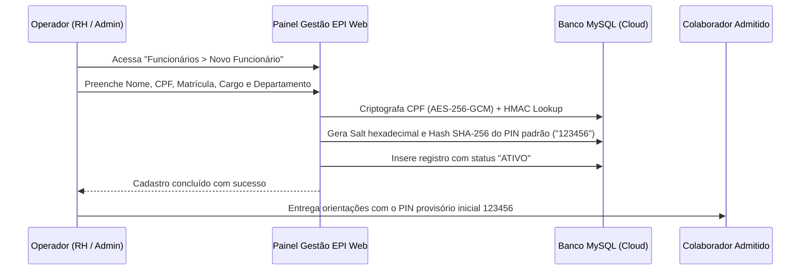
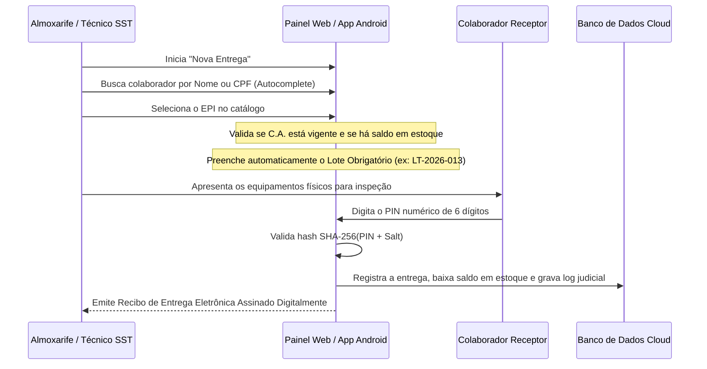

# Fluxos Operacionais e Casos de Uso — Gestão EPI

Este manual instrui os operadores (Técnicos de SST, Analistas de RH, Almoxarifes, Gestores de Contrato e Auditores) na execução dos fluxos de trabalho e processos de conformidade do ecossistema corporativo **Gestão EPI**.

---

## 1. Fluxo de Admissão de Colaborador e Geração de PIN

Todo colaborador admitido na empresa deve ser registrado no sistema para que possa receber equipamentos e assinar eletronicamente os termos de ciência e responsabilidade:

* **Regra de Negócio:** Nenhum colaborador ativo pode ficar sem credencial de assinatura eletrônica. Ao ser cadastrado, o sistema gera de forma automática o PIN padrão `123456` ativo.

---

## 2. Fluxo de Fornecimento de EPI com Assinatura Eletrônica e Lote

Este é o fluxo principal de atendimento operacional no almoxarifado ou no canteiro de obras:

### Regras Estritas de Conformidade:
1. **Lote Obrigatório:** Em atendimento à NR-6 e à versão 8.4.4 do sistema, sob nenhuma hipótese um item de entrega pode ser finalizado ou impresso com o campo de lote exibindo traços (`---`), `N/A` ou vazio.
2. **Snapshot de C.A.:** O número e a data de validade do Certificado de Aprovação no momento da entrega são gravados de forma imutável no recibo (`item_epi_ca_snapshot`), comprovando a legalidade da entrega mesmo após futuras expirações do equipamento.

---

## 3. Fluxo de Devolução e Inspeção Técnica

Quando um EPI é devolvido (por motivo de substituição periódica, término de contrato ou dano):

1. **Acesso à Tela de Devolução:** O operador acessa o menu `Entregas & Devoluções > Devolução` (ou clica no botão Speed Dial FAB `+`).
2. **Localização do Colaborador:** Ao digitar o nome ou CPF no campo com autocomplete, o sistema lista exclusivamente os equipamentos que estão em posse daquele colaborador.
3. **Classificação do Estado do Equipamento:**
   * *Desgaste Natural / Fim de Vida Útil:* Item destinado ao descarte controlado.
   * *Apto para Higienização e Reuso:* O saldo retorna ao estoque físico do almoxarifado.
   * *Dano por Mau Uso:* Registrado para apuração da fiscalização interna.
4. **Encerramento da Custódia:** O sistema abate a pendência de posse do colaborador e emite o comprovante de devolução com hash de rastreabilidade.

---

## 4. Fluxo de Atendimento a Auditorias e Fiscalizações Trabalhistas (MTE)

Em inspeções do Ministério do Trabalho e Emprego ou perícias judiciais trabalhistas:

1. **Consulta da Ficha do Colaborador (`pages/ficha_colaborador.php`):**
   * O técnico localiza o colaborador investigado.
   * A tela exibe o dossiê cronológico unificado: data de admissão, cargos ocupados, todos os EPIs fornecidos, números de C.A. vigentes na data da entrega, números de lote e confirmação de assinatura eletrônica.
2. **Impressão do Modelo Oficial A4 Paisagem (`pages/relatorio_auditoria_impressao.php`):**
   * Gera a folha oficial de fornecimento de EPIs pronta para anexação processual com hash de auditoria criptográfica.
3. **Auditoria de Logs LGPD:**
   * A emissão do relatório é automaticamente registrada na tabela `log_auditoria`, registrando o IP, identificador do operador, data/hora no fuso `America/Sao_Paulo` e finalidade da exportação.
