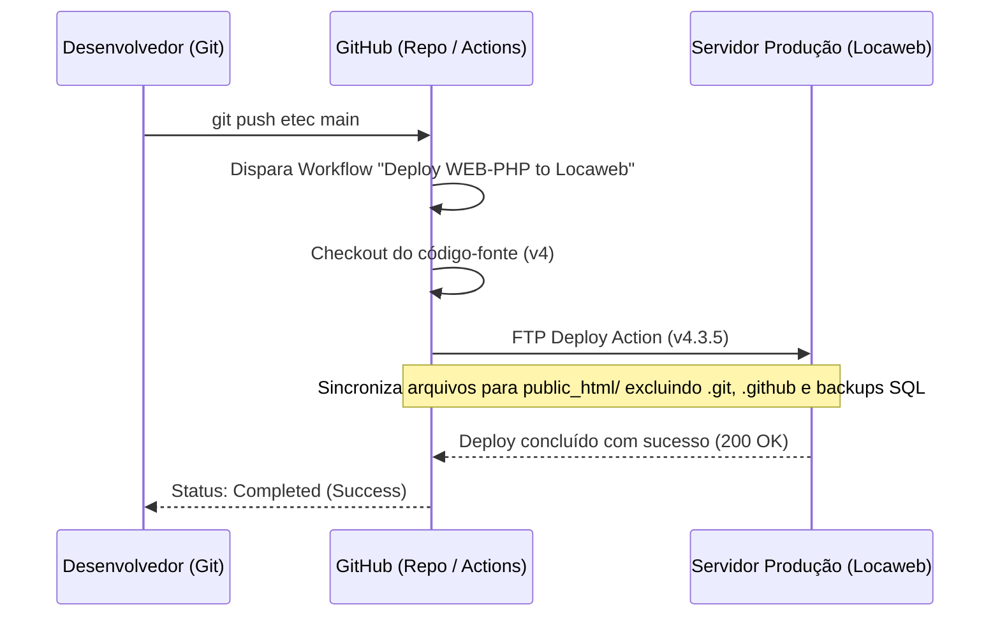

# Guia de Implantação e DevOps — Ecossistema Gestão EPI

Este documento detalha o processo completo de configuração de ambiente, execução local, compilação do aplicativo móvel, deploy contínuo em produção e manutenção preventiva de todo o ecossistema corporativo **Gestão EPI**.

---

## 1. Requisitos Gerais de Infraestrutura

### 1.1 Servidor Web e Linguagem
* **Linguagem:** PHP 8.0, 8.1 ou 8.2+.
* **Módulos PHP Obrigatórios:**
  - `pdo_mysql`: Comunicação segura com o banco relacional.
  - `openssl`: Criptografia de dados sensíveis sob a LGPD (AES-256-GCM).
  - `curl`: Comunicação HTTP entre o Painel Web e a API REST.
  - `json`: Codificação e decodificação de payloads e logs de auditoria.
  - `mbstring`: Suporte a caracteres acentuados da língua portuguesa (pt-BR).
  - `session`: Gerenciamento seguro de sessões com cookies HTTPOnly e Strict.
* **Servidor HTTP:** Apache 2.4+ com módulos `mod_rewrite` e `mod_headers` habilitados.

### 1.2 Banco de Dados Relacional
* **SGBD:** MySQL 8.0+ ou MariaDB 10.3+.
* **Collation / Charset:** `utf8mb4 / utf8mb4_unicode_ci`.
* **Mecanismo:** `InnoDB` com suporte pleno a chaves estrangeiras e integridade referencial.

---

## 2. Instalação e Execução Local (Ambiente XAMPP)

### 2.1 Estrutura de Diretórios Recomendada no XAMPP
```text
C:\xampp\htdocs\
├── gestao_epi_web/     # Código do Painel Web (este repositório)
├── gestao_epi_api/     # Código da API RESTful Backend
└── phpMyAdmin/         # Gerenciamento local do banco de dados
```

### 2.2 Configuração do Banco de Dados Local
1. No painel de controle do XAMPP, inicie os módulos **Apache** e **MySQL**.
2. Acesse `http://localhost/phpmyadmin/` e crie o banco de dados `db_gestao_epi` com charset `utf8mb4_unicode_ci`.
3. Importe o script estrutural inicial `database_schema_v7.sql` localizado na raiz do projeto.

### 2.3 Configuração do Painel Web (`config/api.php`)
Edite o arquivo `config/api.php` para apontar para o endpoint local ou nuvem:
```php
<?php
declare(strict_types=1);

date_default_timezone_set('America/Sao_Paulo');

return [
    'api_base_url' => 'https://gestao-epi-api.onrender.com/', // Ou 'http://127.0.0.1/gestao_epi_api/'
    'app_root_url' => '/gestao_epi_web/',
    'db_host'      => '127.0.0.1',
    'db_name'      => 'db_gestao_epi',
    'db_user'      => 'root',
    'db_pass'      => '',
    'db_port'      => 3306
];
```

### 2.4 Inicialização e Acesso
* **URL do Painel Web:** `http://localhost/gestao_epi_web/`
* **Usuário Inicial:** `admin` | **Senha:** `admin123` (ou `123456`)

---

## 3. Pipeline de CI/CD e Deploy em Produção (Locaweb)

O repositório oficial [projetoEtec26/gestao_epi_web](https://github.com/projetoEtec26/gestao_epi_web) possui uma esteira automatizada de integração e entrega contínua configurada via **GitHub Actions** (`.github/workflows/deploy.yml`):

### 3.1 Funcionamento do Workflow de Deploy


### 3.2 Secrets do GitHub Actions
Para que o deploy funcione, os seguintes segredos devem estar cadastrados nas configurações do repositório no GitHub (*Settings > Secrets and variables > Actions*):
* `FTP_SERVER`: Endereço do host FTP da Locaweb (ex: `ftp.gestaoepi.tecnologia.ws`).
* `FTP_USERNAME`: Usuário com permissão de escrita em `public_html/`.
* `FTP_PASSWORD`: Senha de acesso FTP criptografada.

### 3.3 Endereço de Produção Oficial
* **Painel Web Homologado:** [http://gestaoepi.tecnologia.ws/](http://gestaoepi.tecnologia.ws/)

---

## 4. Compilação e Geração do Aplicativo Android (Mobile)

### 4.1 Requisitos do Ambiente de Desenvolvimento
* **IDE:** Android Studio (versão Ladybug, Iguana ou superior).
* **JDK:** Java Development Kit 17 ou 21 (LTS).
* **Android SDK:**
  - `minSdkVersion`: 24 (Android 7.0 Nougat).
  - `targetSdkVersion` / `compileSdkVersion`: 34 (Android 14 UpsideDownCake).

### 4.2 Configuração da Conexão com o Servidor
No arquivo `gradle.properties` ou na classe `Constants.java` do aplicativo Android:
```properties
# Para testes com emulador oficial do Android Studio conectando ao XAMPP da máquina hospedeira:
API_BASE_URL="http://10.0.2.2/gestao_epi_api/"

# Para conexão direta com o servidor de produção em nuvem:
# API_BASE_URL="https://gestao-epi-api.onrender.com/"
```

### 4.3 Comandos Gradle para Geração do APK

* **Gerar APK de Teste (Debug):**
  ```bash
  ./gradlew assembleDebug
  ```
  O arquivo gerado estará em: `app/build/outputs/apk/debug/app-debug.apk`.

* **Gerar Pacote Assinado para Distribuição Corporativa (Release):**
  ```bash
  ./gradlew assembleRelease
  ```

---

## 5. Rotinas de Backup e Manutenção do Banco de Dados

1. **Backup Diário com mysqldump:**
   ```bash
   mysqldump -u root -p --default-character-set=utf8mb4 --single-transaction --quick db_gestao_epi > backup_gestao_epi_%date:~6,4%-%date:~3,2%-%date:~0,2%.sql
   ```
2. **Auditoria de Integridade Referencial:**
   - Conferir periodicamente se existem registros com lotes nulos:
     ```sql
     SELECT COUNT(*) FROM itens_entrega WHERE item_numero_lote IS NULL OR item_numero_lote = '' OR item_numero_lote = '---';
     ```
     *(O resultado deve ser rigorosamente **0** em conformidade com a NR-6 e v8.4.4).*
