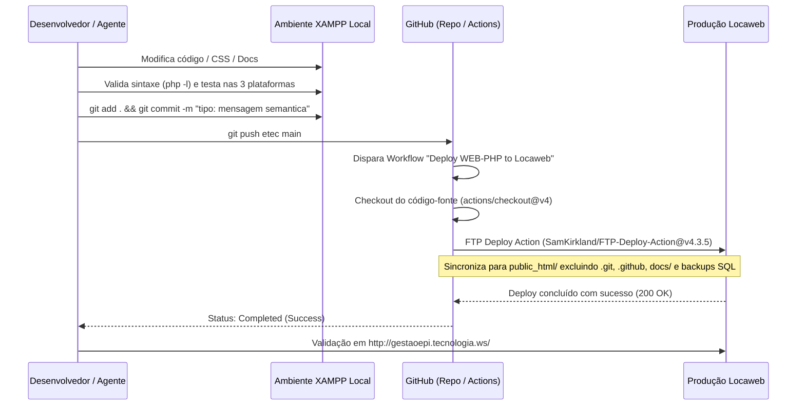

# Guia de Implantação e DevOps — Ecossistema Gestão EPI

Este documento detalha o processo completo de configuração de ambiente, execução local, compilação do aplicativo móvel, deploy contínuo em produção, governança de commits e manutenção preventiva de todo o ecossistema corporativo **Gestão EPI**.

---

## 1. Requisitos Gerais de Infraestrutura

### 1.1 Servidor Web e Linguagem
* **Linguagem:** PHP 8.0, 8.1 ou 8.2+.
* **Módulos PHP Obrigatórios:**
  - `pdo_mysql`: Comunicação segura com o banco relacional.
  - `openssl`: Criptografia de dados sensíveis sob a LGPD (AES-256-GCM).
  - `curl`: Comunicação HTTP entre o Painel Web e a API REST.
  - `json`: Codificação e decodificação de payloads e logs de auditoria.
  - `mbstring`: Suporte a caracteres acentuados da língua portuguesa (pt-BR).
  - `session`: Gerenciamento seguro de sessões com cookies HTTPOnly e Strict.
* **Servidor HTTP:** Apache 2.4+ com módulos `mod_rewrite` e `mod_headers` habilitados.

### 1.2 Banco de Dados Relacional
* **SGBD:** MySQL 8.0+ ou MariaDB 10.3+.
* **Collation / Charset:** `utf8mb4 / utf8mb4_unicode_ci`.
* **Mecanismo:** `InnoDB` com suporte pleno a chaves estrangeiras e integridade referencial.

---

## 2. Instalação e Execução Local (Ambiente XAMPP)

### 2.1 Estrutura de Diretórios Recomendada no XAMPP
```text
C:\xampp\htdocs\
├── gestao_epi_web/     # Código do Painel Web (este repositório)
├── gestao_epi_api/     # Código da API RESTful Backend
└── phpMyAdmin/         # Gerenciamento local do banco de dados
```

### 2.2 Configuração do Banco de Dados Local
1. No painel de controle do XAMPP, inicie os módulos **Apache** e **MySQL**.
2. Acesse `http://localhost/phpmyadmin/` e crie o banco de dados `db_gestao_epi` com charset `utf8mb4_unicode_ci`.
3. Para inicialização de base local de desenvolvimento, utilize scripts DDL seguros sem dados reais ou utilize a conexão direta com o ambiente de testes.

### 2.3 Configuração do Painel Web (`config/api.php`)
Edite o arquivo `config/api.php` para apontar para o endpoint local ou nuvem:
```php
<?php
declare(strict_types=1);

date_default_timezone_set('America/Sao_Paulo');

return [
    'api_base_url' => 'https://gestao-epi-api.onrender.com/', // Ou 'http://127.0.0.1/gestao_epi_api/'
    'app_root_url' => '/gestao_epi_web/',
    'db_host'      => '127.0.0.1',
    'db_name'      => 'db_gestao_epi',
    'db_user'      => 'root',
    'db_pass'      => '',
    'db_port'      => 3306
];
```

### 2.4 Inicialização e Acesso
* **URL do Painel Web Local:** `http://localhost/gestao_epi_web/`
* **Usuário Inicial:** `admin` | **Senha:** `admin123` (ou `123456`)

---

## 3. Governança de Commits e Pipeline de CI/CD (Locaweb)

O repositório oficial [projetoEtec26/gestao_epi_web](https://github.com/projetoEtec26/gestao_epi_web) possui uma esteira automatizada de integração e entrega contínua configurada via **GitHub Actions** (`.github/workflows/deploy.yml`):

### 3.1 Política Institucional de Commit e Publicação Contínua

Toda e qualquer alteração, correção, ajuste, adição ou modificação de código, estilo, configuração ou documentação realizada no projeto obedece estritamente às seguintes diretrizes:

1. **Validação Pré-Commit Obrigatória:**
   - Conferência de sintaxe PHP (`php -l arquivo.php`).
   - Teste prático de funcionamento no XAMPP local.
   - Verificação responsiva obrigatória nas 3 plataformas: Web Desktop ($\ge 1200\text{px}$), Tablet ($768\text{px} – 1199\text{px}$) e Celular ($< 768\text{px}$).

2. **Commit Semântico Padronizado:**
   - Realização compulsória de `git add` dos arquivos pertinentes e `git commit`.
   - Utilização de mensagens semânticas padronizadas (*Conventional Commits*):
     - `feat:` para novas funcionalidades ou componentes.
     - `fix:` para correções de bugs, segurança ou formatação.
     - `docs:` para atualizações de documentação e manuais.
     - `style:` para ajustes visuais ou de formatação CSS/layout.
     - `refactor:` para refatoração de código sem alteração de regra de negócio.
     - `chore:` para tarefas administrativas, regras ou dependências.

3. **Publicação Contínua para o GitHub (`git push`):**
   - Logo após o commit, o desenvolvedor ou agente deve enviar as alterações para o repositório remoto no GitHub (`https://github.com/projetoEtec26/gestao_epi_web.git` na branch `main`).
   - A árvore de trabalho local deve permanecer 100% limpa (`working tree clean`).

4. **Acionamento do Pipeline e Deploy na Locaweb:**
   - O push na branch `main` dispara automaticamente o workflow do GitHub Actions (`deploy.yml`).
   - Os arquivos modificados são sincronizados via FTP para o servidor de produção na Locaweb.
   - O desenvolvedor ou agente deve confirmar a entrega em produção acessando `http://gestaoepi.tecnologia.ws/` e informar expressamente o hash e mensagem do commit.

### 3.2 Diagrama de Sequência do Ciclo CI/CD


### 3.3 Secrets do GitHub Actions
Para que o deploy funcione, os seguintes segredos estão cadastrados nas configurações do repositório no GitHub (*Settings > Secrets and variables > Actions*):
* `FTP_SERVER`: Endereço do host FTP da Locaweb (`ftp.gestaoepi.tecnologia.ws`).
* `FTP_USERNAME`: Usuário com permissão de escrita em `public_html/`.
* `FTP_PASSWORD`: Senha de acesso FTP criptografada.

### 3.4 Endereço de Produção Oficial
* **Painel Web Homologado:** [http://gestaoepi.tecnologia.ws/](http://gestaoepi.tecnologia.ws/)

---

## 4. Compilação e Geração do Aplicativo Android (Mobile)

### 4.1 Requisitos do Ambiente de Desenvolvimento
* **IDE:** Android Studio (versão Ladybug, Iguana ou superior).
* **JDK:** Java Development Kit 17 ou 21 (LTS).
* **Android SDK:**
  - `minSdkVersion`: 24 (Android 7.0 Nougat).
  - `targetSdkVersion` / `compileSdkVersion`: 34 (Android 14 UpsideDownCake).

### 4.2 Configuração da Conexão com o Servidor
No arquivo `gradle.properties` ou na classe `Constants.java` do aplicativo Android:
```properties
# Para testes com emulador oficial do Android Studio conectando ao XAMPP da máquina hospedeira:
API_BASE_URL="http://10.0.2.2/gestao_epi_api/"

# Para conexão direta com o servidor de produção em nuvem:
# API_BASE_URL="https://gestao-epi-api.onrender.com/"
```

### 4.3 Comandos Gradle para Geração do APK

* **Gerar APK de Teste (Debug):**
  ```bash
  ./gradlew assembleDebug
  ```
  O arquivo gerado estará em: `app/build/outputs/apk/debug/app-debug.apk`.

* **Gerar Pacote Assinado para Distribuição Corporativa (Release):**
  ```bash
  ./gradlew assembleRelease
  ```

---

## 5. Rotinas de Backup e Manutenção do Banco de Dados

1. **Backup Diário com mysqldump:**
   ```bash
   mysqldump -u root -p --default-character-set=utf8mb4 --single-transaction --quick db_gestao_epi > backup_gestao_epi_%date:~6,4%-%date:~3,2%-%date:~0,2%.sql
   ```
2. **Auditoria de Integridade Referencial:**
   - Conferir periodicamente se existem registros com lotes nulos:
     ```sql
     SELECT COUNT(*) FROM itens_entrega WHERE item_numero_lote IS NULL OR item_numero_lote = '' OR item_numero_lote = '---';
     ```
     *(O resultado deve ser rigorosamente **0** em conformidade com a NR-6 e v8.4.4).*

---

## 6. Diretrizes de Hardening e Segurança em Produção

Com base no diagnóstico da **Auditoria de Cybersecurity** ([AUDITORIA_CYBERSECURITY.md](AUDITORIA_CYBERSECURITY.md)):

### 6.1 Regras de Hardening no Servidor Apache (`.htaccess`)
Para forçar o uso exclusivo de HTTPS (respeitando o proxy reverso da Locaweb), ativar cabeçalhos defensivos e impedir o acesso direto a arquivos de documentação e backups, o arquivo `.htaccess` na raiz da aplicação está configurado da seguinte forma:
```apache
Options -Indexes

<FilesMatch "(^\.env|^\.git|secrets.*\.php|\.sql$|\.log$|\.md$|Dockerfile|composer\.json)">
    <IfModule mod_authz_core.c>
        Require all denied
    </IfModule>
    <IfModule !mod_authz_core.c>
        Order allow,deny
        Deny from all
    </IfModule>
</FilesMatch>

<IfModule mod_rewrite.c>
    RewriteEngine On
    RewriteBase /

    # Redirecionamento 301 para HTTPS em Produção (compatível com Proxy Reverso Nginx/Locaweb)
    RewriteCond %{HTTPS} off
    RewriteCond %{HTTP:X-Forwarded-Proto} !https [NC]
    RewriteCond %{HTTP:X-Forwarded-SSL} !on [NC]
    RewriteCond %{HTTP_HOST} !localhost [NC]
    RewriteCond %{HTTP_HOST} !127\.0\.0\.1 [NC]
    RewriteRule ^(.*)$ https://%{HTTP_HOST}%{REQUEST_URI} [L,R=301]
</IfModule>

<IfModule mod_headers.c>
    Header set X-Content-Type-Options "nosniff"
    Header set X-Frame-Options "SAMEORIGIN"
    Header set X-XSS-Protection "1; mode=block"
    Header set Referrer-Policy "strict-origin-when-cross-origin"
    Header set Strict-Transport-Security "max-age=2592000" "expr=%{HTTPS} == 'on' || %{HTTP:X-Forwarded-Proto} == 'https'"
</IfModule>
```

### 6.2 Gestão de Segredos e Isolamento Fora da Raiz Pública (Locaweb)
* **Estrutura de Diretórios Segura:** Em produção (Locaweb), as credenciais não residem em arquivos comitados no Git. Utiliza-se um arquivo PHP de segredos com permissão `0600` localizado **fora do diretório público** (`public_html/`):
  ```text
  /home/usuario_locaweb/
  ├── public_html/          <-- Raiz da aplicação Web (deploy FTP do Git)
  └── secrets.php           <-- Arquivo de credenciais fora da raiz pública
  ```
* **Carregamento Automático em `config/api.php`:** A aplicação detecta a existência de `/home/usuario_locaweb/secrets.php` e carrega dinamicamente as credenciais `DB_HOST`, `DB_NAME`, `DB_USER`, `DB_PASS` e `AES_SECRET_KEY`.
* **Firewall do MySQL DBAAS Locaweb:** Configurado no painel Locaweb para rejeitar conexões de endereços IP não autorizados na porta TCP 3306.
